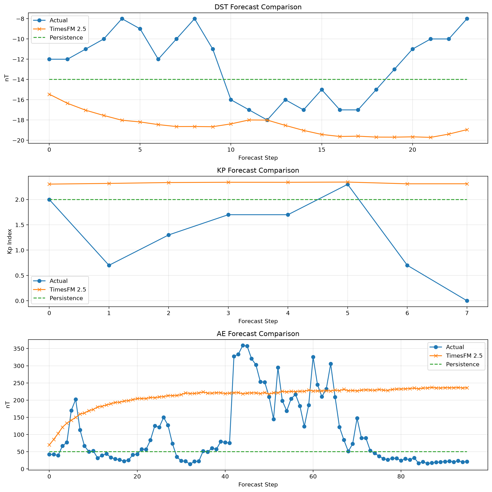
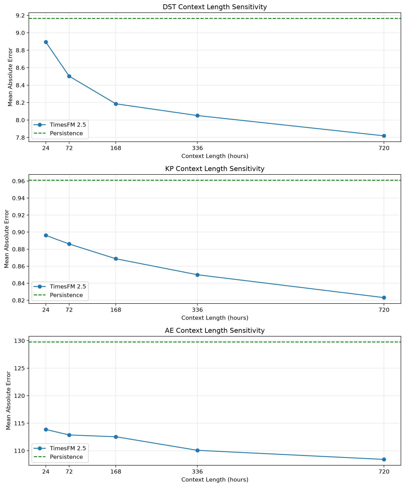
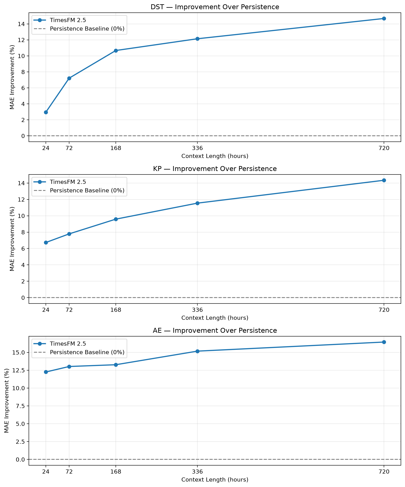

# TimesFM Geomagnetic Forecasting

Evaluating zero-shot forecasting, historical context-length sensitivity, and Low-Rank Adaptation (LoRA) of TimesFM 2.5 on geomagnetic time-series data.

## Overview

This project investigates the transferability of pretrained time-series foundation models to geomagnetic forecasting. Specifically, it evaluates **Google Research's TimesFM 2.5** on three geomagnetic indices: Dst, AE, and Kp.

The primary objective is to determine how effectively TimesFM generalizes to specialized geophysical time series without task-specific training, how historical context length influences forecasting performance, and whether parameter-efficient fine-tuning can further improve accuracy.

This project is being developed as part of **DS 733: Deep Unsupervised Learning** at the New Jersey Institute of Technology (NJIT).

## Research Objectives

The project investigates three approaches:

1. **Zero-Shot Forecasting:** Evaluate pretrained TimesFM 2.5 directly on geomagnetic time series without updating model parameters, comparing its predictions against a persistence baseline.
2. **Historical Context-Length Sensitivity:** Investigate how increasing the amount of historical information available to TimesFM affects forecasting performance without modifying pretrained parameters.
3. **LoRA Fine-Tuning:** Adapt TimesFM 2.5 to geomagnetic data using low-rank parameter updates and compare performance against zero-shot predictions.

## Datasets

The project focuses on geomagnetic indices describing different aspects of Earth's magnetic environment.

| Index | Description | Original Resolution | Evaluation Resolution |
|---|---|---|---|
| **Dst** | Disturbance Storm Time index, measuring large-scale geomagnetic disturbances | 1 hour | 1 hour |
| **AE** | Auroral Electrojet index, describing auroral-zone geomagnetic activity | 1 minute | 15 minutes |
| **Kp** | Planetary geomagnetic index, characterizing global geomagnetic activity | 3 hours | 3 hours |

The AE dataset is aggregated into 15-minute intervals using the mean of the original minute-resolution observations to reduce computational cost while retaining finer temporal information than hourly aggregation.

### Data Sources

- **World Data Center for Geomagnetism, Kyoto:** Historical Dst and AE indices.
- **Geomagnetic index archives:** Historical Kp measurements.

The experiments use historical geomagnetic observations spanning approximately 2000–2020.

## Methodology

### Data Preparation

- Acquire historical geomagnetic index measurements.
- Inspect temporal coverage, missing values, and data quality.
- Convert timestamps and preprocess index measurements.
- Aggregate AE observations into 15-minute intervals.
- Generate sliding historical context windows and forecasting targets.

### Zero-Shot Forecasting

Pretrained TimesFM 2.5 is evaluated without updating its parameters.

Each index is evaluated using seven days of historical context and a 24-hour forecasting horizon, with one forecast origin per day.

| Index | Context Observations | Forecast Observations |
|---|---:|---:|
| Dst | 168 | 24 |
| Kp | 56 | 8 |
| AE | 672 | 96 |

A persistence baseline predicts that the most recently observed value remains constant throughout the forecasting horizon.

Both methods are evaluated against identical targets using Mean Absolute Error (MAE).

### Historical Context-Length Sensitivity

To investigate how TimesFM uses historical observations, context durations of **24, 72, 168, 336, and 720 hours** are evaluated.

Forecast origins and targets are held fixed within each index, ensuring that differences in forecasting accuracy reflect changes in historical context rather than changes in the evaluation windows.

No model parameters are updated during these experiments.

### LoRA Adaptation

*Planned.*

Apply parameter-efficient fine-tuning to TimesFM 2.5 using geomagnetic time-series data. Evaluate whether domain-specific adaptation improves forecasting accuracy relative to the pretrained zero-shot model.

## Experimental Results

### Zero-Shot Forecasting

TimesFM 2.5 outperformed persistence across all three geomagnetic indices.

The results suggest that TimesFM's pretrained representations transfer reasonably well to geomagnetic forecasting without domain-specific fine-tuning.

Individual forecast visualizations show relatively smooth predicted trajectories, particularly for AE, indicating that the model may struggle to reproduce rapid geomagnetic fluctuations despite achieving lower aggregate MAE than persistence.

### Context-Length Sensitivity

Relative MAE improvement over persistence:

Across all three indices, TimesFM's forecasting accuracy improves as additional historical context becomes available.

The 720-hour context achieved the lowest MAE across all three geomagnetic indices, demonstrating that TimesFM benefits from longer historical context.

These results demonstrate context-length sensitivity without parameter updates. They do not, by themselves, establish few-shot or example-based in-context learning.

### Evaluation Metrics

The current experiments use:

- **Mean Absolute Error (MAE):** Average absolute difference between forecasts and observed values.
- **Relative MAE Improvement:** Percentage reduction in MAE compared with persistence.

Additional evaluation metrics and analyses may be introduced during LoRA experiments.

## Project Status

**Status: Zero-Shot and Context-Length Experiments Completed; LoRA Pending**

- [x] Research proposal approved
- [x] Acquire Dst, Kp, and AE datasets
- [x] Preprocess geomagnetic time-series data
- [x] Establish persistence forecasting baseline
- [x] Implement TimesFM 2.5 zero-shot evaluation
- [x] Evaluate Dst, Kp, and AE forecasting
- [x] Implement historical context-length sweep
- [x] Compare zero-shot forecasts against persistence
- [x] Save forecasting outputs and experimental metrics
- [ ] Implement LoRA adaptation
- [ ] Compare LoRA against zero-shot forecasting
- [ ] Analyze final experimental results

## Reproducibility

The repository includes saved zero-shot forecasting outputs in compressed NumPy (`.npz`) format, containing model predictions and corresponding targets.

Context-length experiment results are stored in JSON format.

These outputs allow evaluation metrics and visualizations to be reproduced without repeating model inference.

The forecasting experiments use the pretrained TimesFM 2.5 model with inference performed in PyTorch.

## References

- [TimesFM — Google Research](https://github.com/google-research/timesfm)
- [TimesFM 2.5 — Hugging Face](https://huggingface.co/google/timesfm-2.5-200m-transformers)
- [World Data Center for Geomagnetism, Kyoto](https://wdc.kugi.kyoto-u.ac.jp/)
- [Kyoto Dst Index Portal](https://wdc.kugi.kyoto-u.ac.jp/dstdir/index.html)